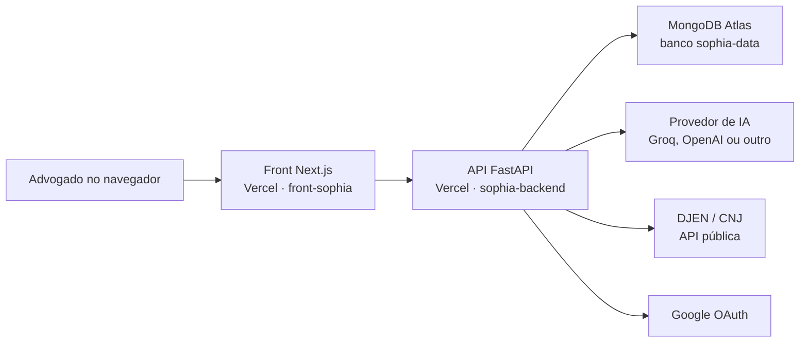

# Sophia — Infraestrutura e ambiente de implantação

Documentação do ambiente em que o MVP do Sophia está publicado e de como uma alteração de código chega até esse ambiente.

| | |
| --- | --- |
| Projeto | Sophia — plataforma web para advogados |
| Repositório | https://github.com/yasmintrentinfanfa/front_sophia |
| Front em produção | https://front-sophia-one.vercel.app |
| API em produção | https://sophia-backend-umber.vercel.app |
| Atualizado em | 24 de novembro de 2026 |

O navegador fala só com o front. O front chama a API. A API guarda os dados no MongoDB e consulta os serviços externos (modelo de linguagem, transcrição e diário de justiça).



## 1. O que está no ar

### Front-end

Aplicação Next.js 16 (App Router), React 19, TypeScript e Tailwind CSS 4. O código das telas fica em `src/`.

| Item | Valor |
| --- | --- |
| Hospedagem | Vercel |
| Projeto | `front-sophia` |
| Time | `sophia-44aa` |
| Repositório ligado | `yasmintrentinfanfa/front_sophia` |
| Framework detectado | Next.js |
| Runtime | Node.js 24.x |
| URL de produção | https://front-sophia-one.vercel.app |
| Domínio próprio | Não há. O endereço público é o domínio da Vercel. |

Não existe `vercel.json` nem Dockerfile. A Vercel usa o build padrão do Next.js (`npm run build`, que executa `next build`) e publica a aplicação como servidor Node, com as rotas de página e as rotas `/api` do App Router.

O último deploy de produção acompanhado neste documento saiu do commit `d56a455` da branch `main` (merge do pull request #30, calendário de prazos) e ficou com estado **READY**.

### Camada do front que fala com a API

As telas não chamam a API direto. Elas chamam rotas `/api` do próprio Next (`src/app/api`). Essas rotas é que falam com o FastAPI, usando `SOPHIA_BACK_URL` (`src/lib/servidor/back.ts`). A variável pública `NEXT_PUBLIC_SOPHIA_TRANSCRICAO` fica vazia de propósito, para a URL e as credenciais da API não irem para o navegador.

A sessão do advogado é um cookie `httpOnly` (`sophia_user_id`), assinado com HMAC-SHA256 (`SESSION_SECRET`). Em produção o cookie só trafega em HTTPS.

### API

API em Python (FastAPI + Uvicorn). O código versionado neste repositório está em `backend/` (`backend/main.py`, módulos `backend/analise` e `backend/prazos`).

O endereço em produção é https://sophia-backend-umber.vercel.app. Esse projeto Vercel está em outra conta da equipe (não no time `sophia-44aa` do front). O front aponta para ele pela variável `SOPHIA_BACK_URL`.

### Banco de dados

MongoDB Atlas, banco `sophia-data`. A URI fica só no ambiente da API (`MONGODB_URI`), nunca no Git.

Coleções usadas pelo código:

| Coleção | Conteúdo |
| --- | --- |
| `users` | Contas. E-mail único. Senha com bcrypt. |
| `case` | Casos, relato (`transcript`) e documentos anexados (`documents`). |
| `analises` | Análise preliminar do caso. |
| `mensagens` | Chat do caso. |
| `pecas` | Minutas geradas. |
| `monitoramentos` | Acompanhamento de intimações por OAB ou processo. |
| `publicacoes` | Publicações lidas no DJEN. |
| `prazos` | Prazos agendados pelo advogado. |

Em desenvolvimento, se `MONGODB_URI` estiver vazia, cadastro e casos caem em arquivos locais em `backend/data/`. Esse fallback não existe em produção.

### Serviços externos

| Serviço | Uso | Segredo |
| --- | --- | --- |
| Provedor de LLM (padrão: Groq; também OpenAI, Anthropic ou Google) | Análise preliminar, chat e minutas | Chave só no servidor da API (`GROQ_API_KEY` ou a chave do provedor escolhido em `SOPHIA_LLM_PROVIDER`) |
| faster-whisper | Transcrição de áudio da entrevista | Roda no processo da API. O modelo carrega na primeira transcrição. |
| DJEN (CNJ) | Intimações em https://comunicaapi.pje.jus.br/api/v1/comunicacao | API pública, sem chave |
| Google OAuth | Botão "entrar com Google" | `GOOGLE_CLIENT_ID` no front e o mesmo valor na API, que confere o token. Vazio = botão oculto. |

## 2. Ambientes

| | Local | Preview (Vercel) | Produção |
| --- | --- | --- | --- |
| Quando | Desenvolvimento na máquina | Push em branch que não é `main` | Merge na `main` |
| Front | http://localhost:3000 (`npm run dev`) | URL `*.vercel.app` daquele deployment | https://front-sophia-one.vercel.app |
| API | http://localhost:8000 (`npm run dev:api` no Windows) | A mesma API de produção | https://sophia-backend-umber.vercel.app |
| Dados | Atlas, se `MONGODB_URI` estiver no `backend/.env`; senão, JSON em `backend/data/` | Banco de produção, via a API de produção | Atlas, banco `sophia-data` |
| Sessão | `SESSION_SECRET` no `.env.local`. Sem ela, o segredo muda a cada reinício do `next dev` e as sessões caem. | `SESSION_SECRET` da Vercel | `SESSION_SECRET` da Vercel. Obrigatória: sem ela o servidor recusa subir a assinatura do cookie. |

O preview do front já aponta para a API e para o banco de produção. Um teste numa branch mexe nos mesmos dados do MVP. Vale tratar a produção como ambiente compartilhado até existir um banco separado de homologação.

## 3. Variáveis de ambiente

Nenhum segredo entra no Git. Os exemplos versionados são `.env.example` (front) e `backend/env.exemplo` (API). Os arquivos reais (`.env`, `.env.local`, `backend/.env`) estão no `.gitignore`.

### Front, no projeto `front-sophia` da Vercel

| Variável | Ambientes | Função |
| --- | --- | --- |
| `SOPHIA_BACK_URL` | production, preview, development | Endereço da API. Valor atual: `https://sophia-backend-umber.vercel.app`. |
| `SESSION_SECRET` | production, preview, development | Segredo que assina o cookie de sessão. |
| `GOOGLE_CLIENT_ID` | production | ID do cliente OAuth (tipo Aplicativo da Web) do Google Cloud. |

`SESSION_SECRET` pode ser gerada com:

```bash
node -e "console.log(require('crypto').randomBytes(32).toString('hex'))"
```

### API, no projeto Vercel que publica `sophia-backend-umber`

Definidas no painel daquele projeto (ou, na máquina local, em `backend/.env`):

| Variável | Função |
| --- | --- |
| `MONGODB_URI` | Conexão com o Atlas. Sem ela, a API local grava em arquivo. |
| `SOPHIA_LLM_PROVIDER` | `groq` (padrão), `openai`, `anthropic` ou `google`. |
| `GROQ_API_KEY` | Chave do provedor padrão. Para outro provedor: `OPENAI_API_KEY`, `ANTHROPIC_API_KEY` ou `GOOGLE_API_KEY`. |
| `SOPHIA_MODEL_*` | Nome do modelo, quando o provedor aposenta o modelo anterior. |
| `GOOGLE_CLIENT_ID` | Mesmo ID do front, para validar o token do login com Google. |
| `DJEN_API_URL` | Opcional. Só para apontar os testes a outro endereço do DJEN. |

## 4. Como o deploy do front acontece

A Vercel está ligada ao GitHub. Não há pipeline separado (não existe pasta `.github/workflows`).

1. A alteração nasce numa branch e entra por pull request.
2. O merge na `main` dispara o build de produção.
3. A Vercel instala as dependências e roda `next build`.
4. Com o deployment em **READY**, o alias https://front-sophia-one.vercel.app passa a servir essa versão.
5. Push em outra branch gera um deployment de preview, com URL própria, sem trocar a produção.

Para voltar atrás: no painel do projeto `front-sophia`, promover um deployment de produção anterior. Os deploys recentes da `main` ficam disponíveis como candidatos a rollback. Não é preciso reverter o Git para desfazer só o que está no ar.

### Subir o ambiente local

Front, na pasta do repositório:

```bash
npm install
npm run dev
```

API, em outro terminal (Windows):

```bash
python -m venv backend/venv
backend\venv\Scripts\activate
pip install -r backend/requirements.txt
copy backend\env.exemplo backend\.env
npm run dev:api
```

Preencher `backend/.env` nesta máquina. A raiz http://localhost:3000 redireciona para `/login`.

Testes do front: `npm test`. Testes da API de análise e prazos: `cd backend && python -m unittest discover -s tests -v`. Esses testes não bloqueiam o deploy: quem publica é o build da Vercel, disparado pelo merge.

## 5. Deploy da API

O código da API viaja neste mesmo repositório, em `backend/`. A publicação em https://sophia-backend-umber.vercel.app é feita no projeto Vercel da outra conta da equipe. Este documento não descreve o painel dessa conta porque ele não está no time `sophia-44aa`.

O que o front exige desse ambiente:

- HTTPS no endereço configurado em `SOPHIA_BACK_URL`.
- `MONGODB_URI` apontando para o Atlas (`sophia-data`).
- Chave do provedor de IA configurada no servidor.
- CORS liberado para o front (a API aceita origem `*` em `backend/main.py`).

Enquanto a API estiver nessa segunda conta, uma mudança em `backend/` na `main` atualiza o GitHub e **não** atualiza sozinha o endereço de produção. Quem for publicar a API precisa fazer o deploy naquele projeto, ou a equipe precisa unificar os dois projetos na mesma conta e no mesmo fluxo de Git.

## 6. Proteção de acesso da Vercel

No projeto `front-sophia`, a Vercel Authentication está ligada para todos os deployments, exceto domínios próprios. Não há domínio próprio. Quem abre https://front-sophia-one.vercel.app sem sessão na equipe `sophia-44aa` pode cair na tela de login da Vercel, antes do Sophia.

A proteção por senha do deployment está desligada.

Para a banca abrir o MVP sem conta na Vercel, a equipe desliga a Vercel Authentication no ambiente de produção do projeto `front-sophia` (Settings → Deployment Protection) ou convida os avaliadores. O e-mail informado no edital é `computacao@atitus.edu.br`.

## 7. O que este ambiente já garante e o que ainda não

Já está em uso:

- Produção separada do código: `main` publica, as outras branches geram preview.
- Segredos fora do Git, com exemplo versionado do que precisa existir.
- Front e API em projetos diferentes, com o navegador isolado da API e do banco.
- Sessão assinada e cookie `httpOnly` / `Secure` em produção.
- Rollback pelo histórico de deployments da Vercel.
- Banco gerenciado (Atlas), sem servidor de banco para a equipe operar.

Ainda não faz parte deste ambiente, e fica como evolução:

- Domínio próprio do Sophia.
- Banco e API de homologação, para o preview deixar de escrever em produção.
- Deploy da API no mesmo fluxo do front (hoje depende da outra conta Vercel).
- GitHub Actions (ou o passo de testes da Vercel) rodando `npm test` e os testes do `backend/` antes de promover a produção.
- Região de execução fixada em documentação de infraestrutura como código. Hoje a região é a padrão da conta Vercel, sem arquivo no repositório.
