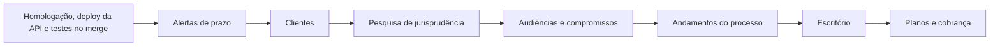

# Sophia — Roadmap de evolução tecnológica

Planejamento do que vem depois do MVP. O produto já cobre a entrevista com o cliente, a análise, o chat, as peças e os prazos. O próximo passo é abrir módulos novos em cima desse fluxo, no mesmo front, na mesma API e no mesmo banco.

| | |
| --- | --- |
| Projeto | Sophia — plataforma web para advogados |
| Repositório | https://github.com/yasmintrentinfanfa/front_sophia |
| Quadro de atividades | https://trello.com/b/sJg9xNKm/sophia-backlog |
| Infraestrutura atual | [docs/infraestrutura-e-deploy.md](./infraestrutura-e-deploy.md) |
| Atualizado em | 24 de novembro de 2026 |

## 1. O que o MVP já entrega

Cada linha abaixo é um módulo em produção. Um módulo novo entra do mesmo jeito: tela no Next.js, rota `/api` no front, código no FastAPI e coleção no MongoDB `sophia-data`.

| Módulo | O que o advogado faz hoje |
| --- | --- |
| Conta | Entra com e-mail ou Google, aceita os termos e cancela a conta. |
| Casos | Abre um caso, escolhe a área jurídica e vê só os casos da própria conta. |
| Relato | Grava, envia áudio ou escreve a entrevista. A transcrição volta para a tela. |
| Análise | Recebe a análise preliminar do caso, com a fonte jurídica citada ou o aviso de que não foi verificada. |
| Chat | Tira dúvidas do caso, anexa documento e atualiza a análise com o que contar. |
| Peças | Gera minuta a partir de 48 modelos, edita na tela e baixa. |
| Repositório | Guarda transcrições e documentos (PDF, DOCX, TXT) do caso. |
| Prazos | Acompanha intimações do DJEN por OAB ou processo e mostra no calendário. |

O cadastro de plano e cartão existiu e saiu do fluxo de propósito. No MVP a conta não pede pagamento.

## 2. Como um módulo novo entra

A ordem de cada módulo é a mesma:

1. O contrato da API ganha as rotas e os campos em `docs/contrato-api.md`.
2. O backend ganha o módulo, a coleção e os testes em `backend/tests`.
3. O front ganha a tela e as rotas `/api`, com a sessão que já existe.
4. `npm test` e os testes do backend passam antes do merge na `main`.
5. O card correspondente sai de Próximas entregas, passa por Em andamento e chega em Concluído no [quadro](https://trello.com/b/sJg9xNKm/sophia-backlog).

Nenhum módulo novo substitui os atuais. O caso continua sendo o centro: cliente, prazo, jurisprudência e andamento apontam para o caso que já existe.

## 3. Melhorias técnicas que sustentam os módulos

Abrir módulo novo direto na produção de hoje mistura teste com caso real. Estas melhorias vêm antes da segunda leva de módulos. O detalhe de cada uma está na [documentação de infraestrutura](./infraestrutura-e-deploy.md) e nos cards da lista Pendente do quadro.

| Melhoria | Para que serve na evolução |
| --- | --- |
| API publicada no mesmo fluxo da `main` | Hoje uma mudança em `backend/` não chega sozinha em https://sophia-backend-umber.vercel.app. Módulo novo no back ficaria no GitHub e fora do ar. |
| Banco e API de homologação | O preview usa o banco `sophia-data` de produção. Módulo em teste não pode gravar caso de advogado real. |
| Testes no caminho do deploy | `npm test` e o `unittest` do backend existem e não bloqueiam o merge. |
| CORS restrito ao front | A API aceita qualquer origem. Módulo novo continua atrás do Next, com a origem limitada ao front e ao localhost. |
| Acesso do MVP sem conta na Vercel | A Vercel Authentication ainda pode esconder o produto de quem não está na equipe. |

Domínio próprio e a descrição da infraestrutura em arquivo no repositório ficam na lista Próximas entregas do quadro. Não travam o primeiro módulo.

## 4. Próximos módulos

Duas levas. A primeira aprofunda o caso que o advogado já conduz sozinho. A segunda abre o escritório: mais gente, mais compromissos e o processo além da intimação.

### Primeira leva

**1. Alertas de prazo**

O DJEN hoje só é consultado quando alguém abre a tela ou aperta "Atualizar agora". O backend é função serverless e não tem rotina própria. O contrato da API já deixa o gancho: uma rotina futura chama `sincronizar_usuario` em `backend/prazos/router.py`.

O módulo avisa o advogado quando entra intimação nova ou quando um prazo que ele marcou está perto do vencimento. A sincronização deixa de depender de alguém lembrar de abrir o Sophia.

Pronto quando a rotina roda sem o navegador aberto, o advogado recebe o aviso e a tela de prazos mostra a data da última sincronização.

### Segunda leva

**2. Audiências e compromissos**

O calendário em `/casos/calendario` mostra prazo. Reunião com cliente e audiência ficam fora dele.

O módulo soma esses compromissos ao mesmo calendário, ligados ao caso. Prazo continua vindo do DJEN e do que o advogado agenda. Audiência e reunião são outro tipo de evento, no mesmo mês.

Pronto quando o mês mostra os três tipos, com filtro, e o compromisso aberto leva ao caso.

**3. Andamentos do processo**

O módulo de prazos lê o DJEN. Ficam de fora, de propósito, as citações do Domicílio Judicial Eletrônico, a intimação que só existe no sistema do tribunal e o diário do STF. A tela já avisa isso.

O módulo de andamentos acompanha a movimentação pública do processo e mostra a linha do tempo no caso, ao lado das intimações que já existem. Cada fonte que continuar de fora segue declarada na tela, como o DJEN faz hoje.

Pronto quando um caso com número de processo mostra os andamentos públicos consultados e a data da última leitura.

**4. Escritório**

Cada caso pertence a um usuário. Não há segundo advogado no mesmo caso nem uma fila do escritório.

O módulo cria o escritório: mais de uma pessoa na conta, caso compartilhado e papéis (quem vê, quem edita). O isolamento atual, em que um usuário não lê caso de outro, continua valendo para quem está fora do escritório.

Pronto quando dois usuários do mesmo escritório abrem o mesmo caso e um terceiro, de fora, recebe que o caso não existe.

### Depois do MVP

**5. Planos e cobrança**

O fluxo de plano e cartão chegou a existir e foi retirado do cadastro e do perfil para o MVP. Volta como módulo próprio quando os módulos da primeira leva estiverem em uso: o advogado escolhe o plano depois de já trabalhar na ferramenta, e a cobrança não bloqueia o relato nem a análise.

Pronto quando a escolha do plano fica fora do cadastro, a cobrança usa um gateway real e a conta sem plano continua entrando no que o MVP já entrega.

## 5. Ordem

Alertas de prazo é o primeiro porque o gancho já está no código e não exige cadastro novo. Clientes vem em seguida porque jurisprudência, andamento e escritório precisam apontar para uma pessoa e para um caso estáveis. Planos fecham a sequência, quando houver uso para cobrar.
